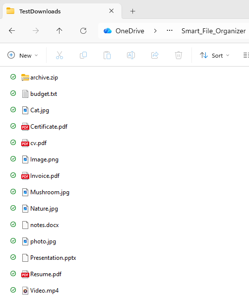
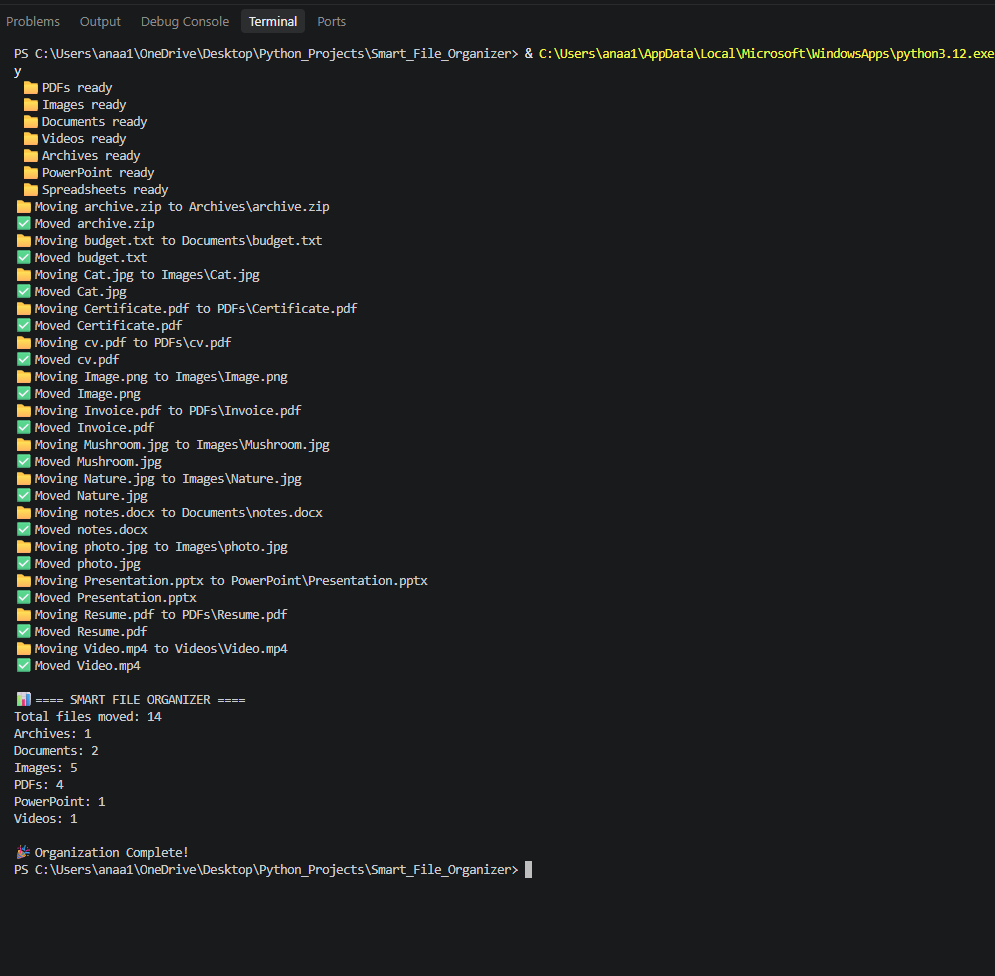
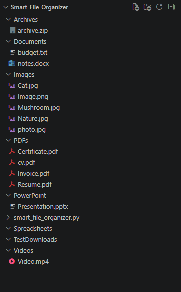
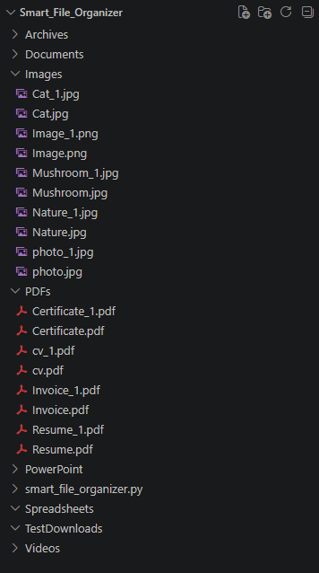

# Smart File Organizer

A Python automation tool that automatically organizes files into folders based on their file extensions.

## Features

✅ Automatic folder creation

✅ File categorization by extension

✅ Duplicate filename handling

✅ File movement and organization

✅ Summary statistics

✅ Error handling

## Technologies Used

- Python
- Pathlib
- Shutil
## Supported File Types

#### Extension	    Category

.pdf     -       PDFs

.docx     -    Documents

.doc      -	   Documents

.txt      -	   Documents

.jpg      -	   Images

.jpeg     -	   Images

.png      -	   Images

.mp4    -	   Videos

.zip    -  	   Archives

.pptx   -	   PowerPoint

.xlsx   -	   Spreadsheets

.csv    -	   Spreadsheets

## Before

The files are mixed together inside the download folder.

## Running the Program

The script creates folders, moves files, and displays a summary.

## After

All files are automatically organized into their corresponding folders.

## Duplicate File Handling

The organizer detects duplicate filenames and automatically renames them to avoid overwriting existing files.

Example:

Cat.jpg

Cat_1.jpg

Resume.pdf

Resume_1.pdf

## Summary Output

Example console output:

📊 ===== SMART FILE ORGANIZER =====

Total files moved: 14

- Archives: 1
- Documents: 2
- Images: 5
- PDFs: 4
- PowerPoint: 1
- Videos: 1

🎉 Organization Complete!

## What I Learned

Through this project I practiced:

- Python functions
- Dictionaries
- Lists and loops
- Error handling with try/except
- File management with Pathlib
- Automation with Shutil
- Debugging and code refactoring

## Future Improvements

- Graphical user interface (GUI)
- User-selected folder path
- Additional file type support
- Automatic file cleanup rules